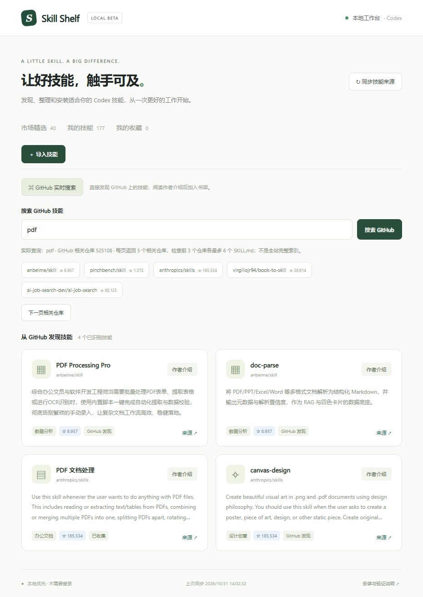

# Skill Shelf · 技能书架

本地运行的 Codex 技能市场 MVP。Node.js 22+，无 npm 依赖，不需要 API Key。包含真实 OpenAI 技能目录快照，可同步、按中文分类浏览、搜索、收藏、导入公开 GitHub 技能目录，扫描已有技能，并管理本项目内安装的技能。



## 下载与快速启动

在 GitHub 仓库页面选择 **Code → Download ZIP**，解压后进入项目目录。Windows 双击 `Start-Skill-Shelf.cmd`，或在 Windows、macOS、Linux 终端执行 `node server.mjs`，然后访问 http://127.0.0.1:4318 。首次使用需要自行安装 Node.js 22+；Codex 对话入口还需要已安装 Codex。管理器不是独立打包的桌面程序。

在项目目录安装 Codex 插件：

```powershell
codex plugin marketplace add .
codex plugin add skill-shelf@skill-shelf-local
```

保持本地服务运行，再新开 Codex 会话。下载或克隆 GitHub 仓库本身不会自动安装插件。

## v0.2：在 Codex 对话中搜索 GitHub

新版本接入 GitHub 实时搜索。启动本地服务、安装本地插件后，在新会话中输入：

> 使用 Skill Shelf 搜索 GitHub 上的 PDF 处理技能，并介绍最相关的几个。

> 用 Skill Shelf 找分镜技能，读取作者 README，再把我选中的结果收集到技能书架。

对话入口会调用本地服务搜索 GitHub；查看详情时返回仓库简介、作者 SKILL.md、至多两份 README 原文或节选、Stars、最近推送时间、许可证标识和固定版本链接。Codex 可据此给出中文摘要。收集只保存目录，不会执行或安装技能。

网页新增“GitHub 实时搜索”，也可搜索、翻页、检查指定仓库、阅读作者介绍和收集技能。常用中文关键词通过固定词典扩展为英文；页面会显示实际查询词，不使用额外模型 API。

默认无需登录：搜索每页 5 个公开相关仓库，检查前 3 个仓库各最多 6 份 SKILL.md，再按关键词匹配技能名称、路径和作者描述。总数是仓库命中数，不是已验证技能数量，也不是全站完整索引。大仓库、目录截断、限流和部分失败会提示。

可选：在启动服务前通过进程环境配置 `GITHUB_TOKEN` 或 `GH_TOKEN`，服务会优先使用 GitHub 的精确代码搜索，每页最多 12 个 SKILL.md 命中。权限不足时回退为仓库发现。仅搜索公开内容。Token 不保存到浏览器、本项目 JSON 或插件配置；Codex 的 GitHub 连接器登录状态不会自动转换为本地服务的 Token。GitHub 代码搜索要求认证，且使用独立的限流配额：[GitHub 搜索文档](https://docs.github.com/en/rest/search/search)。

CLI 示例（以实际安装的插件脚本路径为准）：

```powershell
node plugin/skills/skill-shelf/scripts/shelf.mjs search pdf
node plugin/skills/skill-shelf/scripts/shelf.mjs search 分镜
node plugin/skills/skill-shelf/scripts/shelf.mjs repo anthropics/skills pdf
node plugin/skills/skill-shelf/scripts/shelf.mjs detail https://github.com/anthropics/skills/tree/main/skills/pdf
node plugin/skills/skill-shelf/scripts/shelf.mjs collect https://github.com/anthropics/skills/tree/main/skills/pdf
node plugin/skills/skill-shelf/scripts/shelf.mjs local 文档
```

收集固定 commit 链接会固定来源版本；要跟随分支更新，可导入 `tree/main/...` 分支链接。支持根目录直接包含 SKILL.md 的仓库。

## 启动

Windows 双击 `Start-Skill-Shelf.cmd`，保持终端打开，在浏览器访问 http://127.0.0.1:4318 。也可以在本目录运行：

```powershell
node server.mjs
```

设置 `SKILL_SHELF_PORT` 可更换端口。停止运行：终端按 Ctrl+C。

## 使用

1. 打开“市场精选”，按分类、名称或用途搜索；☆ 收藏会保存在本机。
2. 点击“同步技能来源”更新 OpenAI 公开技能仓库目录。网络失败时保留上次成功的目录。
3. 打开详情，查看上游用途、许可证链接、文件清单与 SKILL.md 原文，再点击安装并确认。
4. 安装到本项目 `.agents/skills`，不会修改个人技能或插件缓存。在 Codex 中打开本项目目录，下一轮或新会话检查是否识别。
5. 已安装技能可重新预览上游，选择更新；更新保留上一安装版本，可回退。检测到本地修改时停止更新、卸载和回退。
6. “导入技能”支持 `https://github.com/owner/repo/tree/ref/skill-path`。分支名含斜杠时需使用 commit SHA。只支持公开 GitHub 仓库。

“我的技能”同时展示项目、个人、兼容旧目录和插件缓存发现的资源。插件缓存存在不代表插件已启用；外部技能只读，不提供卸载操作。

## Codex 插件入口

`plugin/` 是 skills-only 插件，包含查询运行中工作台的对话入口。本版本不依赖未经验证的 Codex 内嵌 UI；可视化界面在本地网页打开。插件不会自动启动后端服务。

本项目提供 `.agents/plugins/marketplace.json`，来源指向 `./plugin`。在本目录执行 `codex plugin marketplace add .`，再执行 `codex plugin add skill-shelf@skill-shelf-local`，然后在新会话中使用。

直接测试入口（先启动工作台）：

```powershell
node plugin/skills/skill-shelf/scripts/shelf.mjs local 文档
node plugin/skills/skill-shelf/scripts/shelf.mjs status
```

插件使用项目内市场清单安装到使用者自己的 Codex 插件缓存。实际模型选用需在新会话中检查；本地 HTTP 服务需保持运行。未接入 Codex 原生插件目录的自定义界面。

## 验证与限制

```powershell
node --test tests/manager.test.mjs tests/discovery.test.mjs
node scripts/sync.mjs
```

- 文件下载按预览 commit 固定版本，验证 Git blob SHA，拒绝越界路径、符号链接和子模块。最多 180 文件、16 MB 总量、5 MB 单文件；不执行下载脚本。
- 质量标识为“来源可追溯、待运行验证”，不等于安全认证或实际运行通过。人工中文介绍与规则分类明确分开。尚无自动功能评测、社区评分、AI 分类或云端服务。
- 默认使用 GitHub 未认证 API；可选服务端 Token。首次详情、多仓库扫描与多文件安装消耗请求较多；内存结果与已校验文件会缓存。遇到限制会提示，保留本地目录。
- 许可证仅检测并链接标准命名文件，使用与再分发授权仍应人工确认。
- 所有写操作串行处理，失败时回退文件移动；正常 I/O 失败会回滚，但断电期间跨文件和状态的事务恢复尚未实现。不支持多进程同时管理同一项目。
- `data/` 保存本机收藏、目录、安装记录与备份；`data/backups` 保留旧文件，目前不自动清理。不要直接删除仍需回退的备份。
- 只监听 IPv4 回环地址，校验 Host、Origin 与会话令牌；不向 GitHub 上传本地技能。此版本用于可信的单机桌面环境，不是多人托管服务。
- 无额外大模型 API 开销。安装的技能自身可能需要付费 API 或额外工具，以其上游说明为准。

## 实现

`server.mjs` HTTP 服务；`lib/manager.mjs` 来源与安装管理；`lib/catalog.mjs` 分类和元数据；`public/` 响应式前端；`catalog.snapshot.json` 真实来源快照；`plugin/` Codex 对话入口。JSON 原子写入适用于单机首版，后续可迁移 SQLite。

官方依据：[插件架构](https://developers.openai.com/plugins/concepts/plugins)、[插件打包与本地市场](https://developers.openai.com/plugins/build/plugins)、[技能发现目录](https://learn.chatgpt.com/docs/build-skills)。
